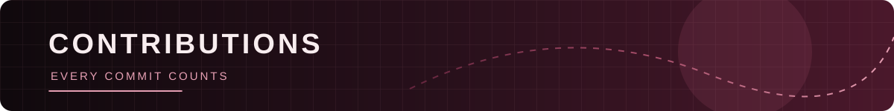

# BHANU VENKAT SAI

### Java Full Stack Developer | AI/ML Enthusiast

*Building useful software. Exploring intelligent systems.*

---

I'm **Jawalkar Bhanu Venkat Sai**, a Computer Science graduate passionate about software engineering, full-stack development, and artificial intelligence.

- 🎓 B.Tech Computer Science and Engineering — 2026
- 🏛️ Kalasalingam Academy of Research and Education
- 📊 CGPA: **8.53**
- 💻 Primary focus: Java Full Stack Development
- 🤖 Exploring Artificial Intelligence and Machine Learning
- 📚 Preparing for GATE 2027 — CS primary, DA secondary
- 🚀 Interested in building meaningful, scalable applications.

---

| Category | Technologies |
|---|---|
| Programming | Java, Java 17, Python, JavaScript, SQL |
| Backend | Spring Boot, Flask, FastAPI, REST APIs |
| Frontend | React.js, HTML, CSS |
| AI/ML | PyTorch, TensorFlow, Scikit-learn, OpenCV, YOLOv8 |
| Data Science | Pandas, NumPy, Matplotlib |
| Database | MySQL, PostgreSQL |
| Tools | Git, GitHub, Docker, Power BI, SonarQube |
| Core CS | DSA, OOP, DBMS, OS, Computer Networks |

---

### 01. Annapurna — Smart Food Waste Reduction System

A smart food management solution designed to monitor inventory and help reduce food waste through intelligent scanning and tracking.

**Technologies:** React · Python · FastAPI · SQLAlchemy · YOLOv8

[VIEW PROJECT →](https://github.com/BHANUVENKATASAI/Annapurna-Smart-Food-Waste-Reduction-System)

---

### 02. Anomaly Detection in Health Devices

A machine learning application designed to identify unusual patterns in wearable health-device data.

**Technologies:** Python · Flask · Pandas · Scikit-learn · Isolation Forest

[VIEW PROJECT →](https://github.com/BHANUVENKATASAI/Anomaly_Detection_In_Healthdevices)

---

### 03. Multimodal Emergency Response System

An intelligent emergency-response solution combining video, audio, and smartphone sensor inputs.

**Technologies:** Python · YOLOv8 · Whisper · FastAPI · OpenCV · Streamlit · React

[VIEW PROJECT →](https://github.com/BHANUVENKATASAI/Multimodal-Emergency-Response-System)

---

### Additional Development Work

- Life Navigator — Smart Scheduler, Local Finder & Financial Assistant.
- Employee Management System — Full-stack employee management application.
- Online Banking System — Banking application using Spring Boot and React.
- Visualizing The Unseen — Brain Signal-to-Image Synthesis using deep learning.

---

- Oracle Cloud Infrastructure 2023 AI Certified Foundations Associate.
- SDGATHON 25 — Team Lead, Top 20 finish.
- CodeChef PRO — Design and Analysis of Algorithms lessons and projects.

---

---

---

<a href="https://github.com/BHANUVENKATASAI">GITHUB</a>
&nbsp; • &nbsp;
<a href="https://www.linkedin.com/in/j-bhanuvenkatasai-3b5269264">LINKEDIN</a>
&nbsp; • &nbsp;
<a href="mailto:mail2bhanuvenkatasai@gmail.com">EMAIL</a>

  

**Open to opportunities, collaboration, and continuous learning.**

