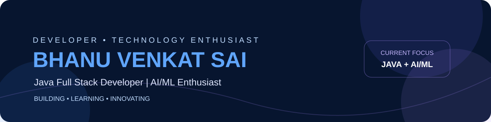
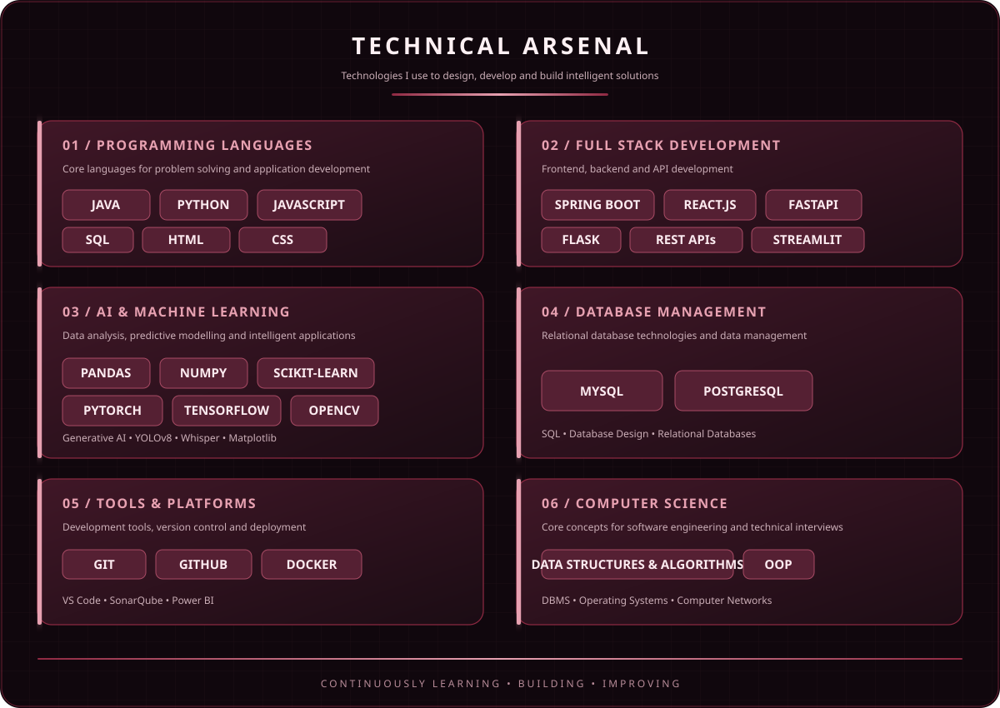
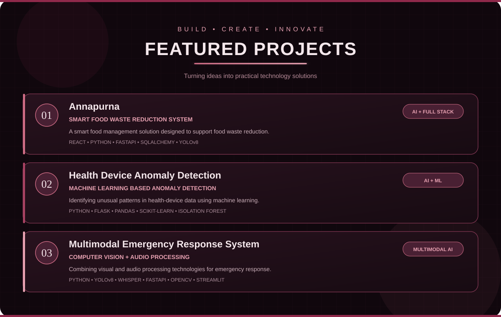
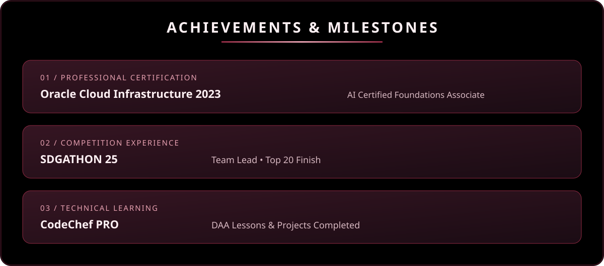
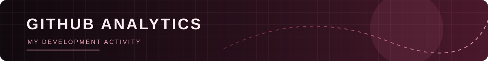
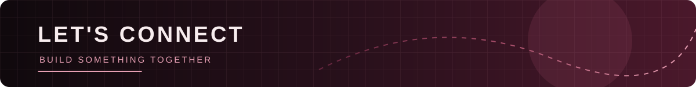

<!-- ====================================================== -->
<!--             BHANU VENKATASAI | PROFILE                 -->
<!--                 BURGUNDY THEME                          -->
<!-- ====================================================== -->

<!-- HERO -->

  

 

<!-- ABOUT -->

  

 

<!-- TECHNICAL SKILLS -->

  

 

<!-- PROJECTS -->

  

 

<!-- ACHIEVEMENTS -->

  

 

<!-- ====================================================== -->
<!--                  GITHUB ANALYTICS                       -->
<!-- ====================================================== -->

  

    

  <!-- GITHUB PROFILE STATISTICS -->

  

  <!-- MOST USED PROGRAMMING LANGUAGES -->

  

    

  <!-- CONTRIBUTION STREAK -->

  

    

  <!-- CONTRIBUTION ACTIVITY GRAPH -->

  

    

  <!-- CONTRIBUTION SNAKE -->

  

 

<!-- CONNECT -->

  

 

<!-- FOOTER -->

  

<!-- ====================================================== -->
<!--                    END OF README                        -->
<!-- ====================================================== -->
